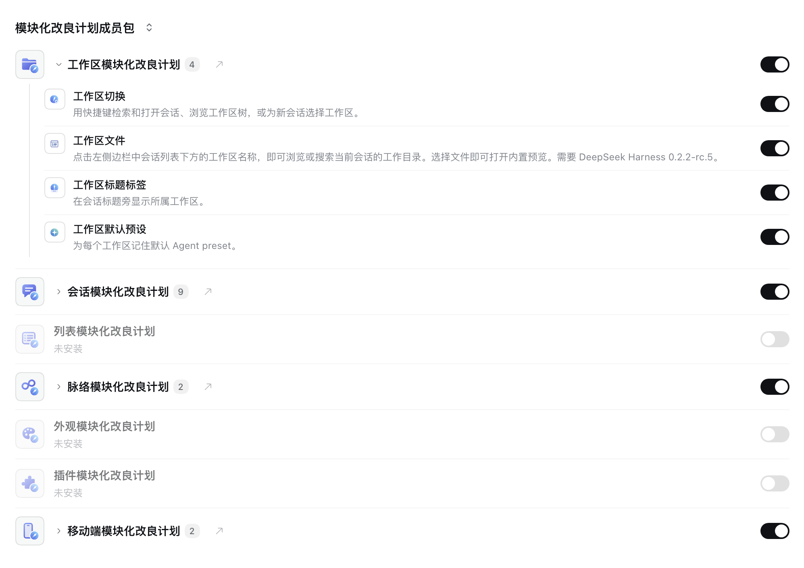

# Atlas Modular Improvement Plan

[简体中文](README.zh.md)

Manage the workspace, session, list, continuity, visual, plugin,
and mobile bundles—and any other installed `dsh.aggregate` bundles—from one page.
In DeepSeek Harness Web or Desktop, open **Plugins → Add plugin** and enter `@miorin/dsh-atlas-atlas`.
Once installed, choose an experience profile or high-level preferences directly in **Settings → Atlas**,
or open **Plugins → Atlas Modular Improvement Plan** to toggle bundles and expand sub-plugin settings inline.
If you prefer not to add a tab to native Settings,
you can turn off the companion **Profile Modular Improvement Plan** row on the bundle detail page.

The manager requires DSH `0.2.2-rc.5` or newer.
DSH checks each member bundle's version requirements when it installs missing bundles from npm.
When you turn on a bundle, the manager reuses the existing installation (including a local link
or overlay) without overwriting its source.
Disable standalone VCS Panel and Sideby Note bundles before enabling Continuity, and disable standalone visual plugins
(or an older List Atlas that still includes Peak pricing timeline) before enabling Visual.
Turning a bundle off keeps the installed copy and its plugin settings.

For local repository switching across `@miorin/dsh-atlas-atlas`, aggregate bundles, and individual sub-plugins,
install [Development Modular Improvement Plan](../dsh-atlas-dev/README.md) (`@miorin/dsh-atlas-dev`)
in a developer profile.

## Screenshots

The **Atlas Modular Improvement Plan** shows the **Mobile Modular Improvement Plan** expanded, with two member switches.
The screenshots show the Chinese UI.

[Main view in dark mode](docs/assets/screenshots/main-dark.png)

[Development and verification](docs/README.md)
