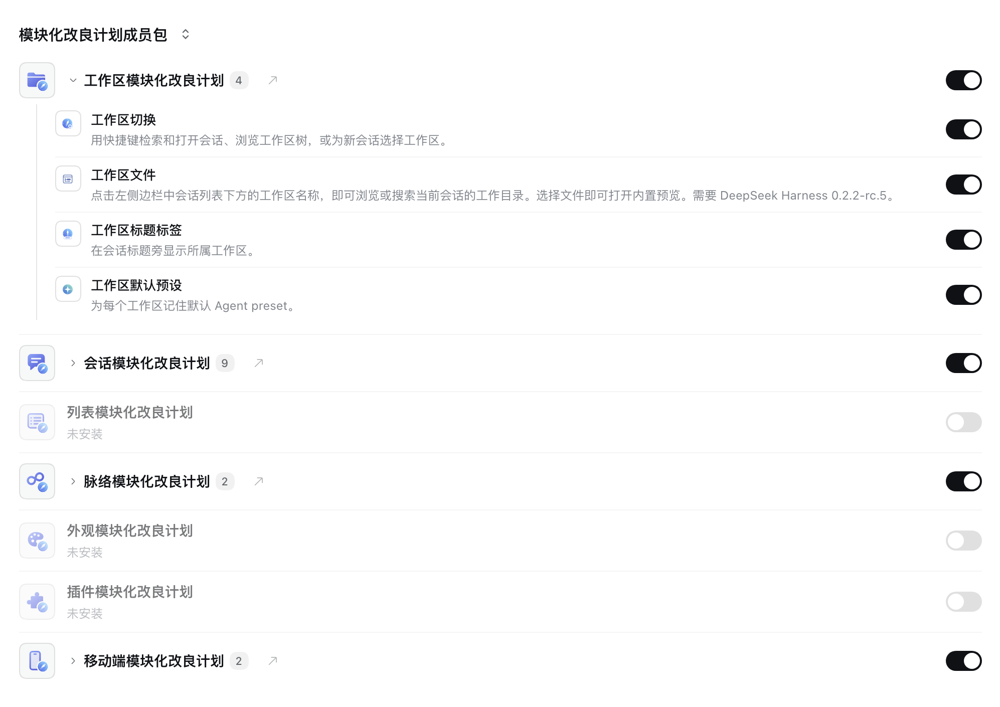

# 模块模块化改良计划

[English](README.md)

在 DeepSeek Harness 的 **插件 → 添加插件** 中输入 `@miorin/dsh-atlas-atlas`，再打开 **插件 → 模块模块化改良计划**。
七个开关分别管理当前 profile 的工作区、会话、列表、脉络、外观、插件和移动端模块化改良计划，
并自动发现 profile 中其他声明了 `dsh.aggregate` 契约的聚合包，在唯一列表内原位展开各子插件的开关与设置。

管理器需要 DeepSeek Harness `0.2.2-rc.5` 或更新版本的 Web 或桌面界面。
DSH 在首次开启尚未安装的成员包时会从 npm 公共 registry 安装并核对其版本要求。
开启已安装的成员时直接复用当前来源（含本地链接或 overlay），不覆盖原有安装方式；关闭开关会停用整包并保留安装和逐项设置。
启用脉络前请先停用单独启用的版本管理与边记部；
启用外观前请先停用单独启用的成员插件（以及仍包含峰谷时间的旧版列表 Atlas）。

需要在 npm 与本地工作区源码仓库之间切换包或单个子插件来源时，
可在开发 profile 中安装独立插件 [开发模块化改良计划](../dsh-atlas-dev/README.zh.md)（`@miorin/dsh-atlas-dev`）。

## 实拍截图

「模块模块化改良计划」中展开了「移动端模块化改良计划」，显示两个成员插件的开关。

[深色模式主图](docs/assets/screenshots/main-dark.png)

[开发与验证](docs/README.md)
